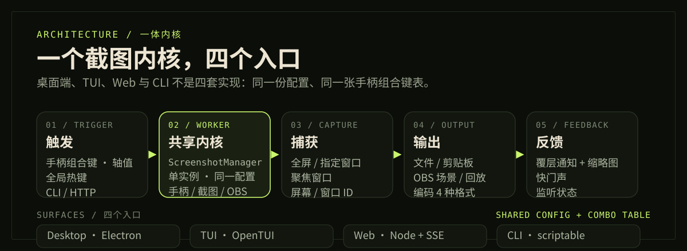
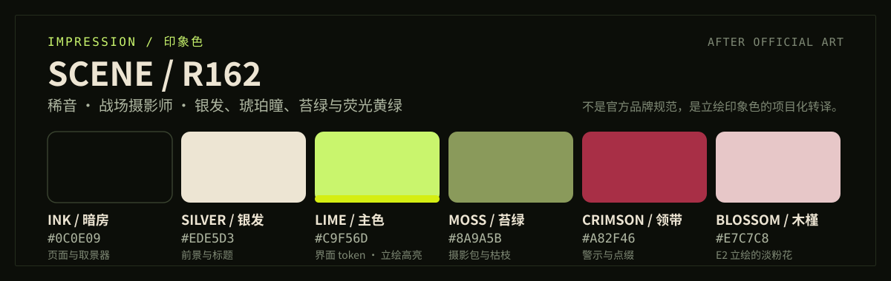

<p align="center">
  
</p>

<p align="center">
  <a href="README.md"><strong>简体中文</strong></a> ·
  <a href="readme/README_EN.md">English</a> ·
  <a href="readme/README_ZH-TW.md">繁體中文</a> ·
  <a href="readme/README_JA.md">日本語</a> ·
  <a href="readme/README_KO.md">한국어</a> ·
  <a href="readme/README_DE.md">Deutsch</a> ·
  <a href="readme/README_FR.md">Français</a> ·
  <a href="readme/README_ES.md">Español</a> ·
  <a href="readme/README_RU.md">Русский</a>
</p>

<p align="center">
  
  
  
  
</p>

**Shiin** 是一个跨 Windows / macOS 的手柄截图与即时回放工具。把全屏、窗口或 OBS 场景截图绑到手柄组合键上，按一下就能保存到文件或剪贴板；长按则保存 OBS 回放缓存。桌面端、TUI、本地 Web 控制台与命令行共用同一个 Node 侧截图内核，不用为了自动化再维护第二套实现。

> 不用切回键盘，也不用中断游戏。

---

## 01 / 先看界面

<p align="center">
  
</p>

<p align="center">
  <sub>工作台：手柄状态、捕获目标、组合键与输出策略在同一屏内完成。</sub>
</p>

<p align="center">
  <a href="readme/images/shot-permissions.png"></a>
  <a href="readme/images/shot-settings.png"></a>
  <br>
  <sub>权限中心会写明缺少哪一项，并可直接打开系统设置 · 设置页负责形状、启动与托盘行为</sub>
</p>

> 截图来自当前 2.0 Web 控制台。macOS 的屏幕录制权限未授予时，权限中心会主动提示，不会让截图静默变成空桌面。

### 能做什么

- **触发** — 手柄组合键或轴值（±0.85 以上视为按下），组合键按设备保存；也支持全局键盘热键。
- **目标** — 全屏（可选显示器）、指定窗口、跟随当前聚焦窗口；窗口不存在会报错，不会偷偷换一扇。
- **保存** — 文件 / 剪贴板 / 两者；PNG / JPG；文件名模板、冲突处理与目录自动创建。
- **直播联动** — OBS WebSocket 场景截图；长按组合键保存回放缓存。
- **反馈** — 透明覆层通知（带截图缩略图）与快门声，桌面、TUI、CLI 共用同一份。
- **入口** — Electron 桌面端、OpenTUI 终端、本地 Web 控制台，以及可脚本化的 CLI。
- **插件宿主** — 同一内核也可打包为 Xaihi 插件（`pnpm build:plugin`，输出 `lib/`、`dist/remoteEntry.js` 与 `cordis.patch.yml`）。
- **macOS 权限中心** — 屏幕录制、辅助功能、输入监控逐项检测；能主动发起系统授权，也能实际抓一帧验证。
- **9 种界面语言** — Material 3 Expressive 暗色界面，35 档形状按角色独立抽取。
- **桌面壳** — 托盘、静默启动、开机自启、启动后自动监听、检查更新。

---

## 02 / 一个内核，四个入口

<p align="center">
  
</p>

桌面、TUI、Web 和 CLI 不是四套实现：它们都从 `createManager()` 取得同一个 `ScreenshotManager`。`shiin serve` 时浏览器只是显示器——关掉页面或刷新，Node 进程里的手柄监听、全局热键、截图与 OBS 连接都不受影响。Web 宿主默认只绑定回环地址，并校验 `Host` 与 `Origin`。

> **边界**
>
> - 全屏 TUI 需要 Node ≥ 26 的 `node:ffi` 或 bun；Node 22 且装了 bun 会显式接力，两者都没有则明确提示改用 `shiin gd`。
> - Web 模式不提供托盘、透明覆层和自动更新；这些壳能力只在 Electron 里。
> - 浏览器里的 Gamepad API 不作为触发真源；监听始终留在 Node 侧。

细节见 [ADR-0008：本地 Web 宿主与共享 ScreenshotManager](docs/adr/0008-web-host-and-shared-screenshot-manager.md)。

---

## 03 / 终端与 Web

```bash
shiin                       # 全屏 TUI 工作台
shiin capture --format png  # 立即截一张
shiin serve                 # 本地 Web 控制台（默认 127.0.0.1:3800）
shiin doctor                # 运行时 / FFI / SDL / OBS / 目录自检
```

TUI 和 `capture` / `replay` 会弹出与桌面端同一份覆层通知；TUI 里按 `N` 可以单测这条通知。键位、旗标、退出码与目录口径见 [docs/cli.md](docs/cli.md)。

---

## 04 / 开始使用

### 桌面端（从源码）

```bash
pnpm install
pnpm build:app
pnpm electron:start   # 开发预览
pnpm pack:app         # 生成当前平台的免安装目录
```

要求 **Node ≥ 22** 与 **pnpm 12.x**。首次使用：

1. 连接手柄，在工作台里录制组合键；
2. macOS 按权限中心提示授予屏幕录制 / 辅助功能 / 输入监控；
3. 开启监听，按下组合键。截图会落到保存目录，也会按设置弹覆层通知。

只想要命令行：

```bash
pnpm install
pnpm build:node
node lib/cli.mjs --help
```

全局安装 `shiin` / `shiin-cli` / `shiin-tui` 的步骤见 [docs/cli.md#全局安装](docs/cli.md#全局安装)。

<details>
<summary><strong>组合键、窗口目标与 OBS 的详细设置</strong></summary>

**组合键**

- 轴值（十字键方向、L2 / R2 扳机……）在 **±0.85** 以上视为按下。
- 组合键按手柄设备保存；换一只手柄要重录，彼此不串。
- 部分手柄在蓝牙下会报告不同的按键索引，配置时优先使用 **USB**。
- 内置测试器会实时点亮按键、轴与十字键。

**窗口目标**

- **指定窗口**：始终截保存的那一扇；窗口不存在就报错。
- **聚焦窗口**：每次触发时读取当前前台窗口。
- 桌面端、TUI 与 CLI 共用 `windowCaptureMode` / `windowSourceId` 配置。

**OBS**

1. 在 OBS 中打开 **WebSocket 服务器**。
2. 截图方式切到 **OBS**，填写 `ws://IP:端口` 与密码，连接。
3. 选择场景；按住组合键即可截取该场景。
4. 开启「长按保存回放缓存」后，长按组合键会把缓存保存为片段。

</details>

---

## 05 / 印象色

<p align="center">
  
</p>

| 颜色 | 色值 | 角色 / 来源 |
| :--- | :--- | :--- |
| Ink / 暗房 | `#0C0E09` | 页面与取景器底色 · 应用 `surface-lowest` |
| Silver / 银发 | `#EDE5D3` | 标题与前景 · 稀音的发色与风衣 |
| Lime / 主色 | `#C9F56D` | 主强调、按钮与快门 · 应用 lime token；立绘高亮为 `#D5EE13`–`#E9FE04` |
| Moss / 苔绿 | `#8A9A5B` | 次级信息与枝条 · 摄影包、E2 枯枝 |
| Crimson / 领带 | `#A82F46` | 警示与少量点缀 · 稀音的领带 |
| Blossom / 木槿 | `#E7C7C8` | 极少量有机点缀 · E2 立绘的淡粉花 |

颜色不是凭印象挑的：荧光黄绿、银白、苔绿、绯红与淡粉来自稀音官方 E0 / E1 与 E2 立绘的局部采样（ImageMagick 量化与取色）。页面用的色值在采样基础上做了少量可读性微调；主色直接沿用 [`src/ui/md3e.tsx`](src/ui/md3e.tsx) 的 lime token `#C9F56D`，让 README 与产品本身保持同一套色。

参考：[PRTS · 稀音](https://prts.wiki/w/%E7%A8%80%E9%9F%B3) · [萌娘百科 · 稀音](https://zh.moegirl.org.cn/zh-cn/%E7%A8%80%E9%9F%B3) · [Arknights Terra Wiki · Scene](https://arknights.wiki.gg/wiki/Scene)

> **同人声明**：Shiin 是非官方项目，与鹰角网络无关联。《明日方舟》及稀音（Scene, R162）相关名称与美术版权归鹰角网络所有；README 只使用抽象色板与取景器 / 摄影图形，不包含官方立绘。

---

## Credits

- 桌面端源自 [AmagiSakuya/GamePad-ScreenShot-Windows](https://github.com/AmagiSakuya/GamePad-ScreenShot-Windows) 的持续演化。
- 界面截图拍自当前 2.0 Web 控制台；README 的 hero、架构图与色板为纯 SVG 手绘。
- 主题印象参考《明日方舟》稀音（Scene, R162）。

## License

[GNU General Public License v3.0](LICENSE)
