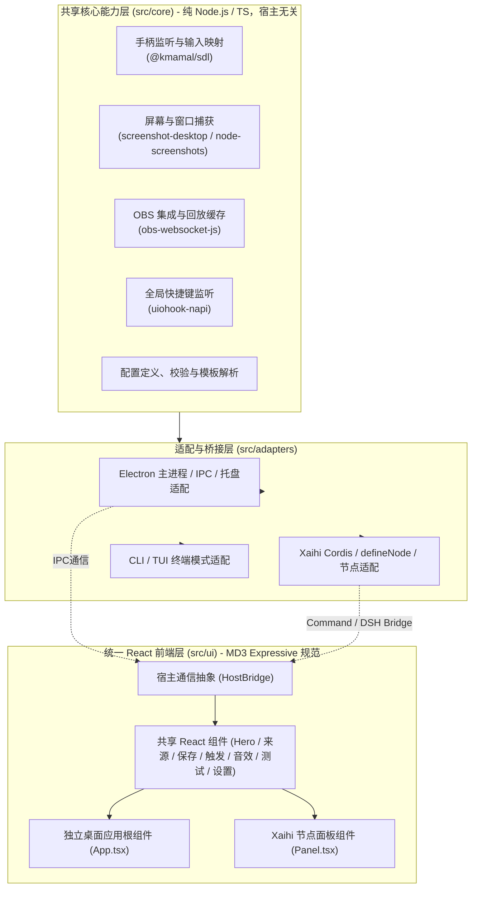

# 游戏截图工具改造为独立 React 应用及标准 Xaihi 插件架构方案

## 一、改造愿景与定位

本项目（Shiin）原为基于 Vue 3 + Electron 的游戏手柄截图与录屏回放工具。本次改造旨在将其演进为：
1. **模式 A：独立应用 (Standalone App)** —— 无需依赖 Xaihi 即可独立安装运行，保留桌面自绘窗口、系统托盘轻量后台运行、自启动、手柄监听、截图、OBS 回放等所有已有功能。
2. **模式 B：标准 Xaihi 插件 (Xaihi Node Plugin)** —— 作为一个标准可安装的 bundle 插件，无缝集成到主 Xaihi 工作台；通过 Module Federation 导出符合 Material 3 Expressive 规范的 React 节点面板，后端遵循 Cordis 与 `defineNode` 规范，支持斜杠命令与操作流。
3. **扩展运行模式：CLI 与 TUI** —— 支持在终端命令行直接执行截图或设备枚举，以及在纯终端字符界面（TUI）下监控手柄按键与监听状态。

---

## 二、架构总览与分层设计

---

## 三、各分层详细实现规范

### 1. 共享核心能力层 (`src/core`)
- **零 UI 耦合**：不引用 Electron、Vue、React 或特定前端状态库。
- **手柄管理 (`src/core/gamepad.ts`)**：
  - 基于 `@kmamal/sdl` 的 SDL2 设备枚举、事件捕获；
  - 维护物理按键、轴（Axis）、十字键（Hat）的状态阵列；
  - 实现组合键按下时长判定（短按截图、长按 1 秒触发 OBS 回放缓存保存）。
- **截图引擎 (`src/core/screenshot.ts`)**：
  - 屏幕捕获：基于 `screenshot-desktop`；
  - 窗口捕获：基于 `active-win` + `node-screenshots`，内置游戏黑帧采样检测算法（避免保存无效黑屏）；
  - 图像编码：PNG 与 JPEG 支持，可配置质量；
  - 保存策略：纯文件、纯剪贴板、文件+剪贴板；自动支持文件名模板替换与同名冲突策略。
- **OBS 连接与回放 (`src/core/obs.ts`)**：
  - 基于 `obs-websocket-js` v5，提供断线重连、场景截图与 `SaveReplayBuffer` 动作。
- **配置抽象 (`src/core/config.ts`)**：
  - 统一的数据结构 `ScreenshotConfig`，在无宿主环境下使用本地 JSON 文件存储，在 Xaihi 宿主下映射为 Cordis / DSH Settings。

### 2. 独立桌面应用与轻量运行 (`src/app/electron` & `src/app/cli`)
- **Electron 桌面外壳**：
  - 保持自绘标题栏（最小化、最大化、关闭、深浅色、主题色切换、整页缩放）；
  - 保留开机自启、单实例锁（SingleInstanceLock）；
  - 托盘常驻：支持右键菜单（打开截图目录、开始/停止监听、退出应用），在关闭主窗口时可无缝退入后台托盘运行；
- **CLI 命令行**：
  - `shiin capture`：直接截屏并保存；
  - `shiin devices`：列出当前连接的手柄与输入轴；
  - `shiin listen`：无 GUI 纯命令行监听手柄。
- **TUI 终端交互界面**：
  - 基于终端 ANSI / 字符交互，提供终端仪表盘，实时刷新手柄按键指示器、监听开关、最近截图记录。

### 3. Xaihi 插件体系接入 (`src/xaihi`)
- **元数据规范**：
  - `package.json#xaihi`: `schema: "xaihi.manifest/1"`, `id: "xaihi-shiin"`, `node: { nodeId: "shiin", actions: [...] }`；
  - `package.json#dsh`: `{ "bundle": { "patch": "./cordis.patch.yml" } }`；
  - `cordis.patch.yml`: 自带 bundle insert 记录。
- **后端服务 (`src/xaihi/index.ts`)**：
  - 导出 Cordis 插件 `name = '@hibernalglow/xaihi-shiin'`；
  - 注入依赖 `['tools', 'commands']`；
  - 声明 `Config` 采用 `@deepseek-ai/schemastery`；
  - 注册 `defineNode`，将核心操作暴露为 Xaihi 节点动作（`capture`, `list_devices`, `start_listen`, `stop_listen`, `obs_save_replay`）；
  - 注册 `/shiin` 斜杠命令，无需模型即可直接从 Composer 和面板触发；
  - 遵循 ADR-0011 铁律：在卸载或宿主关闭时通过 `ctx.effect` 释放手柄监听和资源。
- **前端 Module Federation (`rspack.config.mjs`)**：
  - 打包出 `dist/remoteEntry.js`，导出 `./Panel`；
  - 遵循 Xaihi 规则：`react` 和 `react-dom` 设置 `import: false, singleton: true`，严格依赖宿主提供的 React 运行时。

### 4. 前端从 Vue 迁移到 React & MD 3 Expressive
- **视觉与交互继承**：
  - 继承原有精致的自绘界面、Hero 状态区、按键识别动效、多主题色（Lime, Violet, Cyan, Amber, Rose, Azure）与深浅色模式；
  - 将 Vue 模板与 Options API 改造为现代 React 函数式组件与 Hooks（`useConfig`, `useGamepad`, `useTheme`, `useI18n`）；
  - Xaihi 面板遵循 MD 3 Expressive 规范，优先采用 `--xaihi-*` / `--dsw-*` 语义 token，支持自适应卡片流。

---

## 四、独立构建与发布契约 (Zero Workspace 依赖)

1. **依赖自包含**：
   - 绝不在运行时依赖 `workspace:*`。
   - 将 Xaihi 的纯接口契约（`define-node`、`manifest` 类型）内嵌至 `src/xaihi/sdk/`，随插件构建内联至产物中，产物不输出未发布的内部包名引用。
2. **包管理工具**：
   - 严格使用 `yarn` 安装依赖与执行脚本。
3. **构建产物分离**：
   - `yarn build:app`：构建 Electron 应用的 React SPA 前端与主进程，并使用 `electron-builder` 生成桌面发行安装包；
   - `yarn build:plugin`：通过 `tsdown` + `rspack` 构建出包含 `lib/index.js`、`dist/remoteEntry.js` 和 `cordis.patch.yml` 的独立 npm/tarball 插件包；
   - `yarn build:cli`：打包出可在 Node 环境直接运行的 CLI/TUI 可执行入口；
   - `yarn build`：统一构建所有产物。
4. **CI/CD**：
   - 提供 GitHub Actions 脚本：分别在干净的 macOS 和 Windows 环境中测试、打包独立应用与插件产物。
