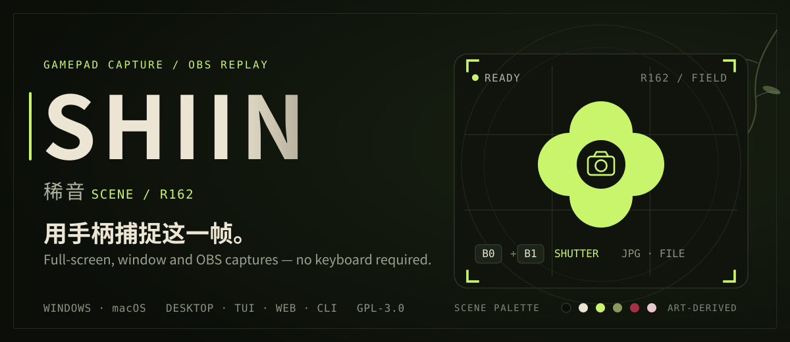
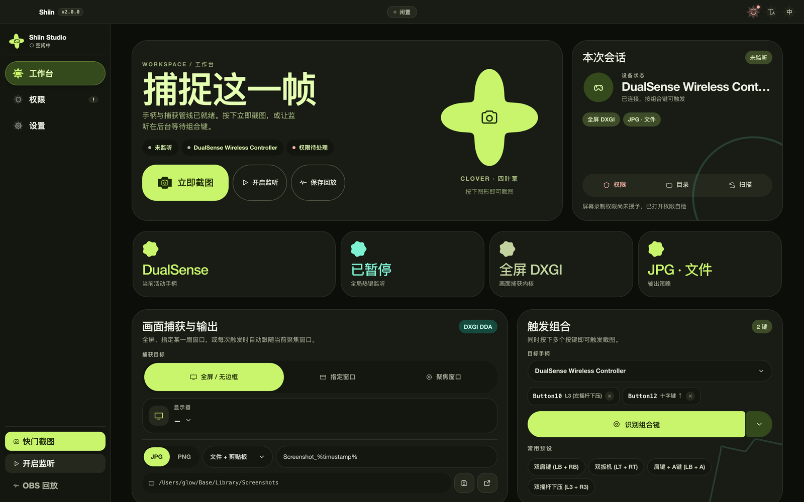
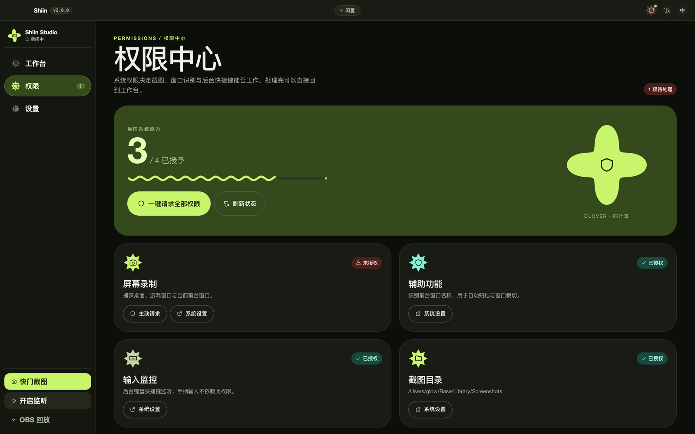
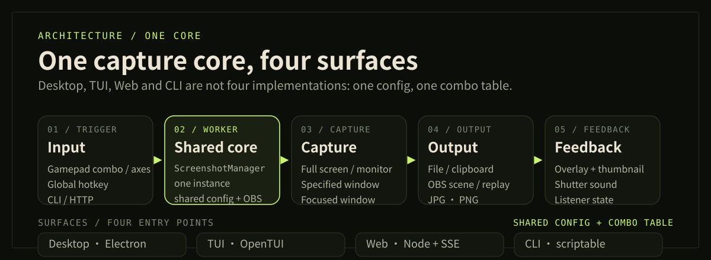
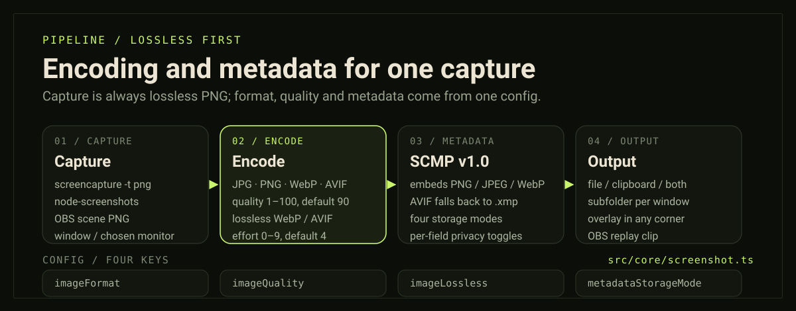
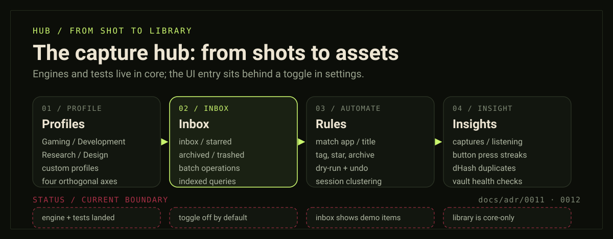
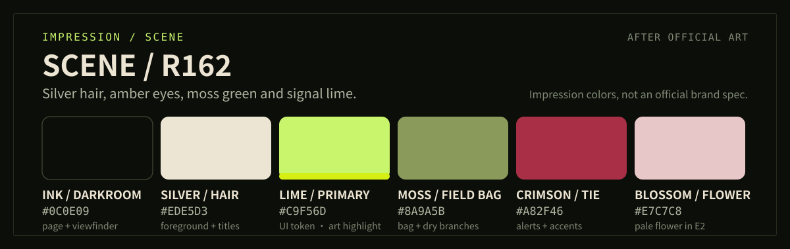

<p align="center">
  
</p>

<p align="center">
  <a href="../README.md">简体中文</a> ·
  <a href="README_EN.md"><strong>English</strong></a> ·
  <a href="README_ZH-TW.md">繁體中文</a> ·
  <a href="README_JA.md">日本語</a> ·
  <a href="README_KO.md">한국어</a> ·
  <a href="README_DE.md">Deutsch</a> ·
  <a href="README_FR.md">Français</a> ·
  <a href="README_ES.md">Español</a> ·
  <a href="README_RU.md">Русский</a>
</p>

<p align="center">
  
  
  
  
</p>

**Shiin** is a gamepad-first screenshot and instant-replay tool for Windows and macOS. Bind full-screen, window, or OBS-scene captures to a controller combo: press once to save to a file or the clipboard, hold to save the OBS replay buffer. The desktop app, TUI, local web console and CLI share one Node-side capture core, so automation does not need a second implementation.

> Stay on the controller. Stay in the game.

---

## 01 / Interface

<p align="center">
  
</p>

<p align="center">
  <sub>Workspace: controller state, capture target, combo and output policy on one screen. UI shown in Simplified Chinese.</sub>
</p>

<p align="center">
  <a href="images/shot-permissions.png"></a>
  <a href="images/shot-settings.png"></a>
  <br>
  <sub>Permissions shows exactly what is missing and opens System Settings · Settings controls shapes, startup and tray behavior</sub>
</p>

> Screenshots are from the current 2.0 web console. When macOS screen recording is missing, the permissions center says so instead of letting a capture silently return an empty desktop.

### What it does

- **Trigger** — Gamepad combos or axes (±0.85 counts as pressed), saved per device; global keyboard hotkeys are also supported.
- **Target** — Full screen (choose a monitor), a specified window, or the currently focused window. A missing window errors out instead of silently picking another.
- **Save** — File / clipboard / both; JPG, PNG, WebP and AVIF, with quality (1–100), a lossless switch and effort (0–9) in the config; filename templates, conflict handling and automatic folder creation stay as before.
- **Metadata** — Every trigger assembles SCMP v1.0 context (foreground app, trigger way, controller, combo, colour space): XMP is embedded in PNG / JPEG / WebP, and AVIF falls back to a `.xmp` sidecar. Privacy fields are toggled one by one.
- **Live production** — OBS WebSocket scene capture; long-press a combo to save the replay buffer.
- **Feedback** — Transparent overlay notification with a thumbnail, plus shutter sounds — shared by desktop, TUI and CLI; the corner is picked in settings (`overlayNotifyPosition`), and the legacy left / right values normalise to the top corners.
- **Capture hub (in progress)** — Profiles, the inbox state machine, session clustering, the automation rule engine and the analytics dashboard already live in `src/core` with unit tests. The only UI entry is the Capture Hub toggle in settings (off by default), and the inbox still renders demo items rather than the real capture stream.
- **Controller visuals** — `@hibernalglow/gamepad-expressive` ships Expressive shapes, button icons and a stick plot for Xbox / PlayStation / Switch / generic pads, and standardises SDL_GameControllerDB mappings onto one button vocabulary; device identity carries guid, vendorId, productId and controller family.
- **Surfaces** — Electron desktop, OpenTUI terminal, local web console and a scriptable CLI.
- **Plugin host** — the same core can be packaged as a plugin for Xaihi (`pnpm build:plugin`, producing `lib/`, `dist/remoteEntry.js` and `cordis.patch.yml`).
- **macOS permissions center** — checks screen recording, accessibility and input monitoring; can request access and run a real capture probe.
- **9 UI languages** — a Material 3 Expressive dark interface, and 35 shape variants drawn independently per role.
- **Desktop shell** — tray, silent startup, launch at login, start listening on launch, update check.

---

## 02 / One core, four surfaces

<p align="center">
  
</p>

Desktop, TUI, web and CLI are not four implementations: they all get the same `ScreenshotManager` from `createManager()`. With `shiin serve`, the browser is only a display — closing or refreshing the page does not stop the gamepad listener, global hotkeys, capture or OBS connection in the Node process. The web host binds to loopback by default and validates `Host` and `Origin`.

> **Boundaries**
>
> - The full-screen TUI needs Node ≥ 26 with `node:ffi`, or bun. On Node 22 with bun installed, Shiin re-executes explicitly under bun; with neither, it points you to `shiin gd`.
> - Web mode has no tray, transparent overlay or auto-update; those shell features live in Electron only.
> - The browser Gamepad API only feeds the core through `POST /api/gamepad/sync` when Node has no physical controller open; as soon as SDL holds a real device, injected state is dropped and triggering goes back to native listening.

See [ADR-0008: local web host and shared ScreenshotManager](../docs/adr/0008-web-host-and-shared-screenshot-manager.md).

---

## 03 / From one shot to one asset

<p align="center">
  
</p>

There is now exactly one capture path: **grab a lossless PNG first** (`screencapture -x -t png` on macOS, `node-screenshots` on Windows, a PNG source from OBS), then let `sharp` encode it according to `imageFormat` / `imageQuality` / `imageLossless` / `imageEffort` in `encodeImageBuffer()` (`src/core/screenshot.ts`). An encoding failure is reported with the format name instead of quietly writing a broken file, and the clipboard writer sniffs the PNG magic so WebP / AVIF output still pastes correctly on macOS.

Metadata follows SCMP v1.0 (XMP + IPTC + Dublin Core) and `metadataStorageMode` decides whether it is embedded, sidecar-only, both, or database-only: PNG / JPEG / WebP can carry XMP inline, while AVIF under `embedIfSupported` automatically degrades to a `.xmp` file. Sidecars are named `basename.ext.xmp` or `basename.xmp`, and window title / app identity are separate privacy switches. Rationale in [ADR-0011](../docs/adr/0011-shiin-capture-metadata-profile-and-indexed-library.md).

<p align="center">
  
</p>

The hub has four layers. **Profiles** are defined along four orthogonal axes — matching, privacy, metadata and pipeline — with Gaming, Development, Research, Design and custom presets built in. **Inbox** tracks inbox / starred / archived / trashed plus batch operations. The **rule engine** maps conditions on app name, window title, dimensions, format and tags to actions such as tagging, starring, archiving or moving to a folder, with dry-run preview and undo rollback, and no dynamic code execution. **Insights and health** record screenshot, listening and controller button events, shooting streaks, dHash duplicate groups and multi-vault storage health.

> **What is actually wired today**
>
> - The engines above are in `src/core` and covered by unit tests; the only clickable surface is the Capture Hub toggle in settings (off by default) with the inbox and workflows panels behind it.
> - The inbox still reads demo fixtures — the capture stream is not written into it — and the indexed multi-source library is core-only, with no button yet.
> - The analytics page accumulates real screenshot, listening and button events, but it starts from a seeded sample and can be cleared to zero.
>
> See [ADR-0012](../docs/adr/0012-universal-capture-hub-inbox-and-workflow-engine.md).

---

## 04 / Terminal and web

```bash
shiin                       # full-screen TUI
shiin capture --format webp --quality 82  # capture once (jpg | png | webp | avif)
shiin serve                 # local web console (default 127.0.0.1:3800)
shiin doctor                # runtime / FFI / SDL / OBS / folder self-check
```

TUI, `capture` and `replay` show the same overlay notification as the desktop app; press `N` in the TUI to test it. Keys, flags, exit codes and storage paths are documented in [docs/cli.md](../docs/cli.md).

---

## 05 / Get started

### Desktop (from source)

```bash
pnpm install
pnpm build:app
pnpm electron:start   # development preview
pnpm pack:app         # unpacked build for the current platform
```

Requires **Node ≥ 22** and **pnpm 12.x**. First run:

1. Connect a controller and record a combo in the workspace;
2. On macOS, grant screen recording / accessibility / input monitoring when the permissions center asks;
3. Start listening and press the combo. The capture lands in the save folder and shows the overlay according to your settings.

CLI only:

```bash
pnpm install
pnpm build:node
node lib/cli.mjs --help
```

Global install steps for `shiin` / `shiin-cli` / `shiin-tui` are in [docs/cli.md](../docs/cli.md#全局安装).

<details>
<summary><strong>Combo, window target and OBS details</strong></summary>

**Combos**

- Axis values (D-pad directions, L2 / R2 triggers, …) count as pressed above **±0.85**.
- Combos are stored per controller. Switching to another controller means recording again; they do not leak across devices.
- Some controllers report different button indices over Bluetooth; prefer **USB** while configuring.
- The built-in tester lights up buttons, axes and the D-pad in real time.

**Window target**

- **Specified window**: always captures the saved window; if it no longer exists, Shiin reports an error.
- **Focused window**: reads the current foreground window on every trigger.
- Desktop, TUI and CLI share `windowCaptureMode` / `windowSourceId`.

**OBS**

1. Enable the **WebSocket server** in OBS.
2. Switch the capture method to **OBS**, enter `ws://IP:port` and the password, then connect.
3. Pick a scene; hold the combo to capture it.
4. With “save replay buffer on long press” enabled, holding the combo saves the buffer as a clip.

</details>

---

## 06 / Impression palette

<p align="center">
  
</p>

| Color | Value | Role / source |
| :--- | :--- | :--- |
| Ink / Darkroom | `#0C0E09` | Page and viewfinder background · app `surface-lowest` |
| Silver / Hair | `#EDE5D3` | Titles and foreground · Scene's hair and coat |
| Lime / Primary | `#C9F56D` | Primary accent, buttons and shutter · app lime token; artwork highlight is `#D5EE13`–`#E9FE04` |
| Moss / Field bag | `#8A9A5B` | Secondary information and branches · camera bag, E2 dry branches |
| Crimson / Tie | `#A82F46` | Alerts and a small accent · Scene's tie |
| Blossom / Hibiscus | `#E7C7C8` | A tiny organic accent · pale flowers in the E2 artwork |

These colors are not guesses. Signal lime, silver, moss, crimson and pale pink were sampled from Scene's official E0 / E1 and E2 artwork (ImageMagick quantization and region sampling). The page values are lightly adjusted for readability; the primary accent directly reuses the lime token `#C9F56D` from [`src/ui/md3e.tsx`](../src/ui/md3e.tsx), so the README and the product share one palette.

Sources: [PRTS · 稀音](https://prts.wiki/w/%E7%A8%80%E9%9F%B3) · [Moegirlpedia · 稀音](https://zh.moegirl.org.cn/zh-cn/%E7%A8%80%E9%9F%B3) · [Arknights Terra Wiki · Scene](https://arknights.wiki.gg/wiki/Scene)

> **Fan project notice**: Shiin is unofficial and unaffiliated with Hypergryph. Arknights, Scene (稀音, R162) and related artwork belong to Hypergryph. This README uses only an abstract palette and camera / viewfinder graphics; it contains no official character art.

---

## Credits

- The desktop app evolves from [AmagiSakuya/GamePad-ScreenShot-Windows](https://github.com/AmagiSakuya/GamePad-ScreenShot-Windows).
- Interface screenshots were taken from the current 2.0 web console. The hero, architecture diagram, pipeline diagram, hub diagram and palette are hand-authored SVG.
- Controller mappings come from [SDL_GameControllerDB](https://github.com/mdqinc/SDL_GameControllerDB) (Zlib) and the line art from the [Gamepad Line Art Pack](https://gidedin.itch.io/gamepad-line-art-pack) (CC0 1.0); both ship inside `packages/gamepad-expressive` with their own license files.
- The visual theme references Arknights Scene (稀音, R162).

## License

[GNU General Public License v3.0](../LICENSE)
